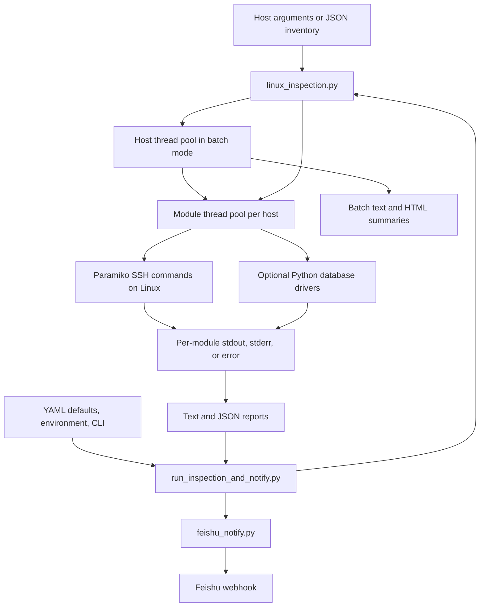

# Linux Perf Check

Collect Linux host diagnostics over SSH and turn repeated command-line checks into text, JSON, and HTML inspection reports.

The Python CLI supports individual hosts and JSON inventories. Its main engineering choices are a declarative check registry, separate host and module thread pools, and an independent SSH connection for each parallel SSH check. An optional wrapper sends a report summary to a Feishu/Lark bot.

This is an adaptation of a provided MIT-licensed snapshot. The original `wanghel2020` copyright notice is retained; see [provenance and contribution boundaries](docs/provenance.md). Local verification covers offline behavior; live SSH, databases, and webhook delivery have not been revalidated for this publication.

## Capabilities

- **Host diagnostics:** system information, CPU, memory, disk, networking, processes, logs, security observations, hardware, middleware, backup-file observations, and resource alerts.
- **Selective execution:** choose modules with `--check`; configure parallelism with `--workers` and `--module-workers`, or use a serial fallback.
- **Reports:** optional per-host text/JSON files, batch text summaries, and a self-contained HTML comparison report with expandable details.
- **Optional database collection:** Python runners for MySQL, Oracle, and SQL Server, plus MySQL CLI query groups for health, security, locks, backup configuration, and index observations.
- **Agent workflow:** [SKILL.md](SKILL.md) and generic reference documents guide an external agent through collection and interpretation. The scripts contain no LLM client or model calls.

The registry contains **21 modules**. Database query compatibility depends on server version and privileges. `db_backup` inspects metadata; `db_sql` inspects schema/index metadata. See the [module catalog](docs/modules.md) for their actual scope.

## Architecture



MySQL query groups run through the target's `mysql` command. The MySQL Python runner includes an SSH-forwarding fallback; Oracle and SQL Server runners use direct connections. Details and tradeoffs are in [architecture](docs/architecture.md).

## Install and try without a server

The commands below use a **Windows PowerShell client with Python 3.11**. The inspection target must be Linux; command availability and permissions vary. No Linux distribution or macOS client compatibility matrix has been validated.

Run from the repository root:

```powershell
py -3.11 -m venv .venv
.\.venv\Scripts\python.exe -m pip install -r requirements.txt
.\.venv\Scripts\python.exe scripts/linux_inspection.py --help
.\.venv\Scripts\python.exe examples/render_sample.py
```

The example renders an HTML report and text summary under `reports/synthetic-demo/` using [entirely synthetic data](examples/inspection.synthetic.json). It makes no SSH, database, model, or webhook calls. Report labels and much of the inherited command output are in Chinese. Rendering validates the report path, not live collection or alert accuracy.

## Inspect an authorized Linux lab

Use an existing SSH key provisioned for your lab. Replace the illustrative host, user, and key path below. This command selects a small module set and explicitly saves both report formats:

```powershell
.\.venv\Scripts\python.exe scripts/linux_inspection.py --host linux.example.invalid --user inspector --key "$env:USERPROFILE/.ssh/linux_perf_check" --check system,cpu,memory,alert -o reports/lab.txt --json-output reports/lab.json
```

For batch mode, copy the inventory template:

```powershell
Copy-Item examples/inventory.example.json inventory.json
```

Edit `inventory.json`: replace the target details and set `enabled` to `true` for the hosts you intend to inspect. Then run:

```powershell
.\.venv\Scripts\python.exe scripts/linux_inspection.py --inventory inventory.json --workers 1 --module-workers 3 --html
```

This starts with one host at a time while allowing parallel modules. Host parallelism is implemented, but the inherited stdout capture is process-wide; see [limitations](docs/architecture.md#known-limitations). The unedited template has no enabled hosts and cannot start an inspection. Reports and actual configuration files are ignored by Git.

Use explicit modules for a first run. `--check all` includes file/log scans, JVM attachment, and database runners; it is not a lightweight connectivity test.

## Optional integrations

The [configuration guide](docs/configuration.md) explains inventory fields, database driver requirements, and notification setup. The notification wrapper reads `config/default.yaml` with `LINUX_PERF_*` overrides. The main collector uses CLI arguments or `--inventory`. Neither script loads `.env` files.

For the notification wrapper, start by copying its separate template:

```powershell
Copy-Item config/default.example.yaml config/default.yaml
```

Fill in the local `server` fields and set `FEISHU_WEBHOOK_URL` in the process environment; set `FEISHU_SECRET` if your bot uses signing. Then `scripts/run_inspection_and_notify.py` runs one inspection and sends one message. Running it contacts the configured host and webhook. Scheduling belongs to an external scheduler.

## Verification

No test suite or dependency manifest accompanied the original snapshot. The publication adds a dependency manifest and the offline rendering example. See [validation results](docs/validation.md) for the exact environment, checks, and unverified paths.

Repeat the basic local checks without a target:

```powershell
.\.venv\Scripts\python.exe -m compileall -q scripts examples
.\.venv\Scripts\python.exe scripts/linux_inspection.py --help
.\.venv\Scripts\python.exe scripts/feishu_notify.py --help
.\.venv\Scripts\python.exe scripts/run_inspection_and_notify.py --help
.\.venv\Scripts\python.exe examples/render_sample.py
```

The offline checks establish import, argument parsing, configuration, formatting, and selected orchestration behavior. They do not establish database correctness, live notification delivery, performance improvements, or production readiness.

## Code map and limits

| Location | Responsibility |
| --- | --- |
| [scripts/linux_inspection.py](scripts/linux_inspection.py) | Check registry, SSH execution, database runners, thread pools, report generation |
| [scripts/run_inspection_and_notify.py](scripts/run_inspection_and_notify.py) | Configuration precedence, one-shot inspection, summary composition |
| [scripts/feishu_notify.py](scripts/feishu_notify.py) | Webhook payloads, optional HMAC signing, HTTP response handling |
| [examples/](examples/) | Disabled inventory template and synthetic report example |
| [SKILL.md](SKILL.md) | External agent runbook; independent of the Python runtime |
| [references/](references/) | Generic diagnosis and report-writing guidance |

Important inherited limits: SSH host keys are automatically accepted; module failures do not reliably make the CLI exit nonzero; timeouts do not enforce a hard job deadline; and HTML metadata escaping is incomplete. Reports can contain sensitive host data. The JVM check uses `jmap -histo:live`, which can trigger Full GC. Review [operational limits](docs/architecture.md#known-limitations) before any live use.

PostgreSQL diagnostics, arbitrary SQL execution/rewrite, automated backup execution, trend forecasting, and an embedded AI diagnosis service are not implemented. The two older SSH helper scripts are retained as [legacy entry points](docs/configuration.md#legacy-helpers), outside the documented quick start.

## License

[MIT](LICENSE), retaining `Copyright (c) 2026 wanghel2020`. This repository's initial publication commit records the supplied snapshot and preparation changes; it does not establish personal authorship of the inherited implementation.
